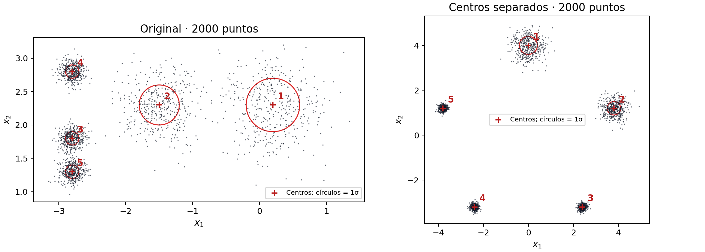
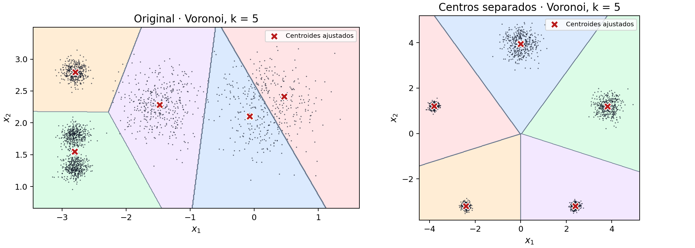
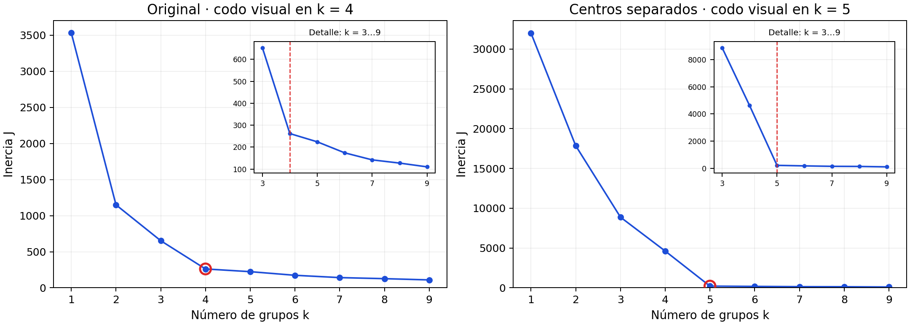
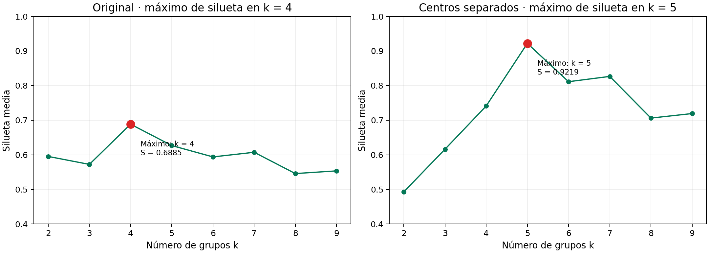
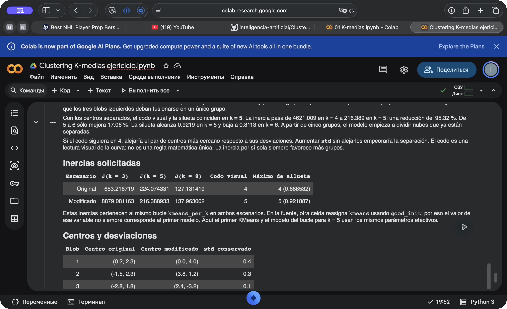

# Clustering K-medias ejericicio

[Abrir notebook ejecutada en Colab](https://colab.research.google.com/github/ZeratulUX/curso_IA_LIC/blob/main/Clustering%20K-medias%20ejericicio/Clustering%20K-medias%20ejericicio.ipynb) · [Descargar/ver notebook](Clustering%20K-medias%20ejericicio.ipynb)

## Ejercicio 1: separar los blobs y volver a elegir k

Usé una copia de `01 K-medias.ipynb`. Primero ejecuté las celdas originales y después repetí el experimento moviendo únicamente los centros. Conservé 2000 puntos, `random_state=7`, los cinco `std` y los mismos parámetros de KMeans. El bucle prueba k = 1,…,9. La silueta se calcula sobre todos los puntos para k = 2,…,9.

## Lo que observé

En los datos originales marcaría el codo en **k = 4**. La inercia baja de 653.217 con k = 3 a 261.797 con k = 4. Pasar de 4 a 5 sólo la reduce 14.41 %. La silueta también prefiere **k = 4**, con 0.6885, frente a 0.6268 en k = 5. Aunque se generaron cinco centros, eso no obliga a que los criterios elijan cinco grupos. En particular, los dos blobs inferiores de la izquierda están separados por sólo 0.5 unidades y pueden agruparse juntos con una penalización pequeña de inercia. No significa que los tres blobs izquierdos deban fusionarse en un único grupo.

Con los centros separados, el codo visual y la silueta coinciden en **k = 5**. La inercia pasa de 4621.009 en k = 4 a 216.389 en k = 5: una reducción del 95.32 %. De 5 a 6 sólo mejora 17.06 %. La silueta alcanza 0.9219 en k = 5 y baja a 0.8113 en k = 6. A partir de cinco grupos, el modelo empieza a dividir nubes que ya están separadas.

Si el codo siguiera en 4, alejaría el par de centros más cercano respecto a sus desviaciones. Aumentar `std` sin alejarlos empeoraría la separación. El codo es una lectura visual de la curva; no es una regla matemática única. La inercia por sí sola siempre favorece más grupos.

## Inercias solicitadas

| Escenario | J(k = 3) | J(k = 5) | J(k = 8) | Codo visual | Máximo de silueta |
|---|---:|---:|---:|---:|---:|
| Original | 653.216719 | 224.074331 | 127.131419 | 4 | 4 (0.688532) |
| Modificado | 8879.081163 | 216.388933 | 137.963002 | 5 | 5 (0.921887) |

Estas inercias pertenecen al mismo bucle `kmeans_per_k` en ambos escenarios. En la fuente, otra celda reasigna `kmeans` usando `good_init`; por eso el valor de esa variable no siempre corresponde al primer modelo. Aquí el primer KMeans y el modelo del bucle para k = 5 usan los mismos parámetros efectivos.

## Centros y desviaciones

| Blob | Centro original | Centro modificado | std conservado |
|---|---|---|---:|
| 1 | (0.2, 2.3) | (0.0, 4.0) | 0.4 |
| 2 | (-1.5, 2.3) | (3.8, 1.2) | 0.3 |
| 3 | (-2.8, 1.8) | (2.4, -3.2) | 0.1 |
| 4 | (-2.8, 2.8) | (-2.4, -3.2) | 0.1 |
| 5 | (-2.8, 1.3) | (-3.8, 1.2) | 0.1 |

Los círculos rojos del scatter representan una desviación estándar; no son límites de los blobs. Hay 400 puntos por nube. El esquema siguiente es aproximado; las posiciones exactas están en la tabla.

```text
Original                       Modificado
 y                              y
2.8   4 (0.1)                   4           1 (0.4)
2.3             2 (.3)  1 (.4)   1.2  5 (.1)       2 (.3)
1.8   3 (0.1)                  -3.2     4 (.1)  3 (.1)
1.3   5 (0.1)                      -3.8 -2.4  0  2.4 3.8 → x
     -2.8     -1.5     0.2 → x
```

## Comparación antes y después

### Scatter


### Voronoi con k = 5


### Codo


### Silueta


Las gráficas comparativas muestran todos los valores y amplían k = 3,…,9 en el codo. Las figuras iniciales de la notebook conservan los límites y la flecha fija de la fuente; esa flecha no calcula el codo. Los ocho PNG individuales están en `figuras/`.

## Reproducibilidad y ejecución

- Entorno de esta corrida: **Google Colab**.
- Python 3.13.16; NumPy 2.1.3; scikit-learn 1.6.1; Matplotlib 3.10.0.
- Fecha UTC de ejecución: 2026-10-15T01:52:18.451312+00:00.
- La notebook conserva las celdas originales y añade esta comparación después de la sección de la imagen. Regenera `X` desde `make_blobs` para evitar usar los píxeles de la catarina.
- `metricas.json` incluye parámetros, centros, versiones y huellas de los datos. `resultados.csv` contiene las 18 inercias y 16 siluetas.
- Las aserciones comprueban 2000 puntos, 5 centros, 400 muestras por nube, residuos gaussianos iguales y parámetros iguales entre escenarios.
- La captura del entorno se entrega en `evidencias/`. La notebook `.ipynb` conserva las salidas ejecutadas.

## Fuente

[Enunciado del ejercicio](https://github.com/victoruccetina/inteligencia-artificial/blob/main/Clustering%20K-medias/Ejercicios/ejercicio-01.md) · [Notebook de referencia](https://github.com/victoruccetina/inteligencia-artificial/blob/main/Clustering%20K-medias/Notebooks/01%20K-medias.ipynb).

## Evidencia real de Colab

La captura muestra la notebook, la conexión a la máquina de Colab y la tabla obtenida en la ejecución.



Para repetir únicamente la comparación en un entorno local con estas dependencias: `python experimento.py`. Para volver a ejecutar todas las secciones, abre la notebook en Colab y selecciona **Entorno de ejecución → Ejecutar todas**. El script local indica su propio entorno y no reemplaza la evidencia de la corrida entregada.
